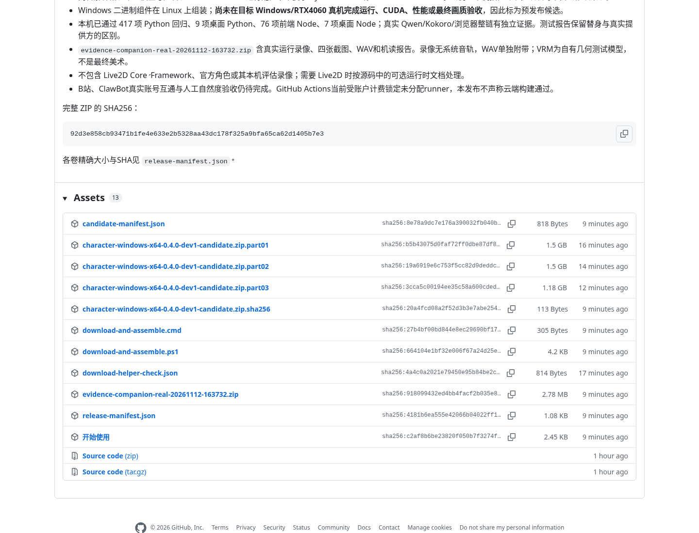

# Windows 便携候选版下载

[打开 GitHub Release 下载页](https://github.com/HarryShenwunai/AI-radio-stream-help/releases/tag/v0.4.0-dev1-candidate)。完整包分三卷，合计4.18GiB。

1. 下载 [download-and-assemble.cmd](https://github.com/HarryShenwunai/AI-radio-stream-help/releases/download/v0.4.0-dev1-candidate/download-and-assemble.cmd) 和 [download-and-assemble.ps1](https://github.com/HarryShenwunai/AI-radio-stream-help/releases/download/v0.4.0-dev1-candidate/download-and-assemble.ps1)，放进同一个文件夹。
2. 双击CMD；脚本下载三卷，校验每卷和完整ZIP的SHA256，再合并。已手动下载的正确分卷会复用。
3. 完整解压生成的ZIP，进入目录，双击 `companion-desktop.exe`。可先运行 `诊断本机.cmd`；报告仅留本机。

下载三卷约4.18GiB，合并ZIP另约4.18GiB，解压目录约6.32GiB；脚本会保留分卷。

完整包包含解释器、本地模型、声音、ASR及CPU/CUDA运行配置。Live2D vendor运行时/官方角色及仅本机评估录像不在公开交付内。

这是在Linux组装的Windows候选包；Windows/RTX4060真机、实际CUDA、真实平台互通及最终视觉/自然度仍待验收。源码/本机回归不代替这些结果。包内BUILD-INFO绑定源码d01ccc42bbe6795c216afae37dd0e53128ab58d9。

[下载实际运行证据ZIP](https://github.com/HarryShenwunai/AI-radio-stream-help/releases/download/v0.4.0-dev1-candidate/evidence-companion-real-20261112-163732.zip)包含真实Qwen/Kokoro整链录像、四张截图、WAV和机读报告。录像没有系统音轨，音频独立附带；VRM为自有几何测试模型，不是最终美术。

[候选清单](candidate-manifest.json) · [分卷SHA清单](release-manifest.json) · [下载工具检查](download-helper-check.json)。GitHub自动生成的Source code ZIP是源码，软件本体请按上面的步骤下载。

[公开下载校验](public-download-check.json) · [附件完整性](release-integrity.json) · [浏览器实测](release-browser-check.json)。
