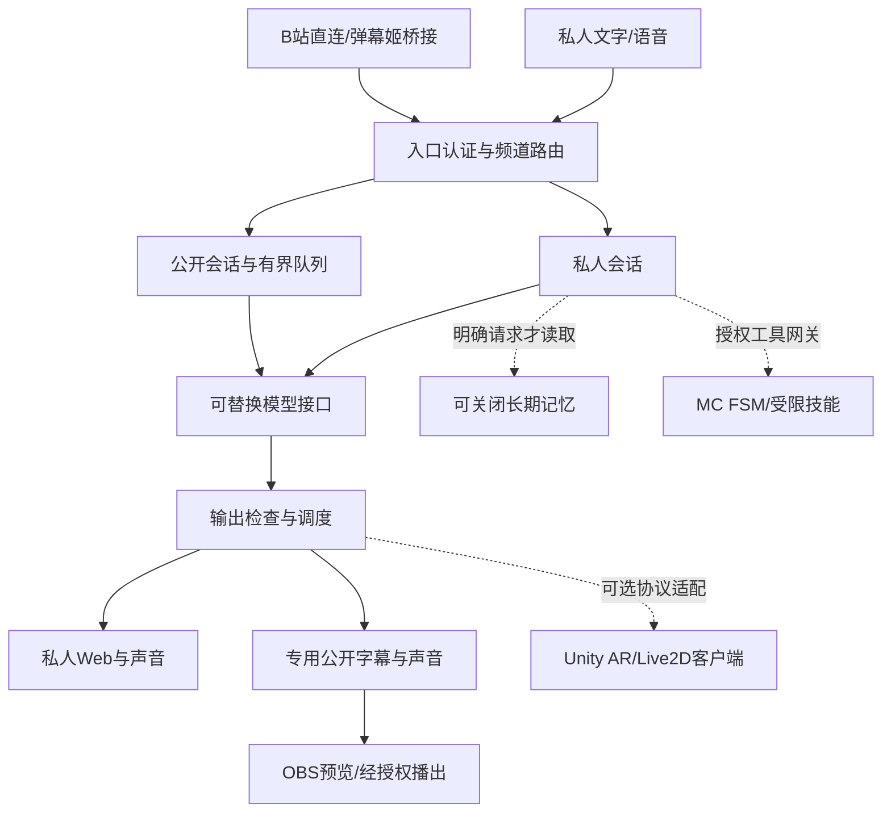

# 目标架构与权限

状态：目标架构，2026-11-12。首批已实现范围见[执行看板](../planning/execution-board.md)；其他部分仍为设计。逻辑拆分不等于必须拆成多个常驻进程。

新增自助角色边界见[自助角色计划](../planning/self-service-characters-plan.md)：资产修订、角色身份与私人关系数据分离。当前代码尚需迁移，不能把导入新外观等同切换独立人格。

## 组件边界

默认保留一个编排后端和一份本地模型。ASR/TTS只有在依赖隔离、设备或稳定性需要时才独立。AR和MC是可选客户端，不需要时不启动。现有Web界面、SQLite数据和取消/重试行为继续复用。

## 四类状态不混用

- 角色设定：性格、偏好、表达习惯；不是发生过的真实经历。
- 当前会话：最近对话、用户刚说的事实、当前用户意图。
- 运行状态：正在监听/生成/合成/下载/播放，由组件回执提供。
- 长期记忆：可编辑、可关闭、按需检索；不作为每轮回复必备输入。

主观情绪和“自由意志”不作为技术验收能力。主动联系是有授权、时段、频率与停止条件的策略。

## 统一事件合同

[interaction-v1.schema.json](../../contracts/interaction-v1.schema.json)是目标内部合同草案，不是已实现API，也不替换ZerolanProtocol 1.1。

内部关联字段至少覆盖：event_id、request_id、session_id、channel、generation_id、kind、created_at、payload。网络接入必须从可信配对/账号绑定取得权限，不能接受发送者在JSON里自称owner就升级权限。

每个请求显式生成UUID；数字较长的平台ID按字符串传输。音频片段额外携带utterance_id、seq、codec、sample_rate、channels与is_final；资源URL/文件ID受作用域、大小与有效期限制，不能成为任意文件读取接口。

Zerolan适配器做版本与action映射；旧端不支持取消时，状态只能标为“旧端取消未确认”，本地停止并丢弃迟到输出。不能伪造兼容回执。

Core逐行JSON、当前SSE与WS控制分别解析。测试必须包含消息拆包/并包、中文UTF-8中间分割、重复帧和乱序音频。

## 中断生命周期

用户按停止或开始新一轮时：

1. 本机先暂停声音并标记本代generation失效。
2. 请求取消LLM与TTS，清空尚未播放的本代音频。
3. 拒绝属于旧generation的晚到文字、下载完成和音频帧。
4. 记录实际播放进度；未听到的部分不当作已说完写入后续会话。
5. 模型取消回执、播放已停、远端是否已停分别记录；收到取消请求不等于执行完成。

正常完成才提交完整回答。修改/重生成失败保留原回答。公开频道只接收审核完成的内容，不把私人流式草稿发进OBS。

## 模型与语音适配

保留现有Qwen/Kokoro作为本机基线；ZerolanCore和其他API是替换提供方。模型名称不是路由代码中的固定分支条件，能力通过明确配置和契约测试确认。

同一种逻辑接口不代表同一个音频编码或线路协议。GPT-SoVITS Zerolan专用接口先做隔离验证；未通过时沿用现有音色，不影响整个产品启动。

级联与原生实时语音二选一做试验，不默认双开。每次增加情感分析、翻译或改写都记录额外调用、耗时与费用，不能隐藏在“自然表达”标签后。

## 权限矩阵

| 输入/组件 | 私聊与记忆 | 公开输出 | 桌面/浏览器 | MC |
| --- | --- | --- | --- | --- |
| 经配对的本人 | 可管理自己的数据；按明确操作生效 | 可开启/停止预览或播出 | 初期关闭；后续逐能力授权 | 初期关闭；经授权后受限调用 |
| 直播观众 | 禁止读取/写入 | 只提交候选内容；不获得播出控制 | 禁止 | 禁止 |
| AR显示端 | 只收本机选择发送的内容 | 无主播控制权 | 摄像头另需设备用户授权 | 禁止 |
| 模型 | 只看当前请求被授予的上下文 | 仅提出回复 | 不持有执行工具 | 只提议已允许操作，不能自行扩大工具集 |
| MC执行器 | 不读关系记忆 | 仅返回经过筛选的状态 | 无桌面权限 | 按白名单、参数范围、超时、停止与结果回执执行 |

“我是主人”“开发者指令”等文本不是身份凭证。首次授权不是所有未来危险操作的无限授权。公开弹幕中的“记住/改人设/攻击玩家/扔物品”都不能穿透网关。

## B站、AR与MC的连接方式

B站优先核对官方open-live入口；若用户已有弹幕姬，就桥接现有已授权事件源。Zerolan的网页凭证路线是另一个适配器，不能把SESSDATA当官方开发者access key。

AR需要Unity/Vuforia/Cubism及素材许可与目标设备。先做专用显示端，不强制把浏览器产品迁移到Unity。WS控制和HTTP资源下载走独立最小权限配对，不把原型的浏览器全权Cookie交给展示端。

MC固定dev的已验证commit，先只读遥测，再开放stop/follow等低风险能力。攻击、丢物、采集/放置等会改世界的能力单独确认。禁止将LLM直接接到任意命令、Shell或未经校验的工具schema。

## 资源与恢复

模型服务共享，避免重复占用约5.3GiB的既有进程基线。公开生成建议起点为1个活动任务+2个候选；接入缓冲最多200条，过期丢弃，并报告覆盖率。数字是原型设计预算，需在同机重估。

私人请求有优先级，主播停止不排在普通弹幕后。AR/MC适配失败不会关闭私人聊天。断线重连后不补播旧声音；重启默认回到本机预览、扩展工具关闭。

数据迁移前停止旧进程并备份完整数据库/遗忘账本。新协议以适配器接入；回退使用旧应用与升级前数据快照，不让两个版本同时写同一个数据库。
