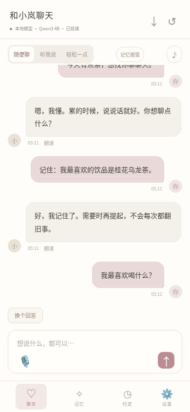

# 现有设计与实际状态

> 本页保存v0.2历史基线；已获准启动后的当前代码与验证见[执行看板](../planning/execution-board.md)。

日期：2026-11-12。该文件来自已有工作区的实现与测试记录，不是重新从零设计。

## 已有可复用基础

- 单用户本地Web界面；Python标准库HTTP/SQLite后端。
- Qwen3-4B-Instruct-2507社区GGUF本地推理，以及可选Chat Completions API。
- 真实SSE回复、停止生成、失败重试和原回答保留。
- 本地Kokoro中文语音、浏览器语音输入和移动端语音开关。
- 独立性格/偏好、随便聊/倾听/轻松相处方式。
- 当前聊天优先；按意图检索最多3条、450字长期记忆；可关闭长期记忆读取。
- 约定延期、取消、自报完成；安静时段与默认关闭的规则主动问候。
- 导出恢复、遗忘账本、来源/会话请求校验；仅监听127.0.0.1。

## 已有证据

36项后端测试、5项本机模拟模型协议测试、Chromium交互与布局验证已经记录。真实Qwen3输出、Kokoro WAV、浏览器播放与提醒、Linux编译程序已验证。

独立原生单次观测：

| 项目 | 观测 | 范围 |
| --- | --- | --- |
| 关闭长期记忆时首段文字 | 9.229秒 | 首次加载场景 |
| 完整回复 | 11.205秒 | 一条合成测试输入 |
| 事实短答 | 3.628秒 | 一个已保存事实 |
| 停止生成 | 0.086秒 | 一个生成中请求 |
| 中文语音合成 | 3.419秒 | 3.743秒音频 |
| 进程RSS/高水位 | 5569316KiB，约5.31GiB | Linux、4核配额、16GiB内存上限 |

来源：[原生测试记录](../../evidence/native-v0.2.json)。这些不是p95、最低配置或直播性能保证，也没有与上游做同机对照。

12个有限质量场景有4次改写，但不是人工质量全部通过；仍有未覆盖的场景描写和不准确细节。见[原型审查](../../evidence/prototype-review-v0.2.json)。

## 当前缺口

目前不能把公众弹幕直接送入私聊接口：存储和记忆没有公开频道隔离，且私聊接口支持明确“记住”写入。停止模型、停止TTS、停止播放器与清理未播放上下文尚未形成跨端统一协议。

尚无微信、B站、弹幕姬、OBS专用公开输出、真实Live2D、AR或MC接入。Windows/macOS只有启动脚本，未真机验收。当前形象是静态SVG。

## 历史原型界面

图片中的旧称呼为历史占位，功能状态按上文说明，不代表正式命名或新版视觉设计。

## 本轮范围

只调查、比较、修订设计并同步GitHub，不购买、不上线、不连接账号、不加入游戏服务器。原型安装包和权重留在原交付渠道，不写入本仓库。
