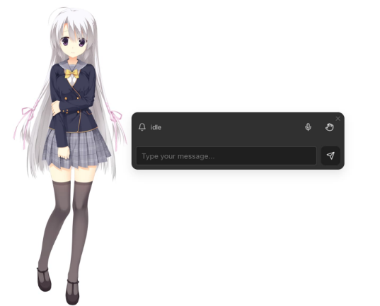
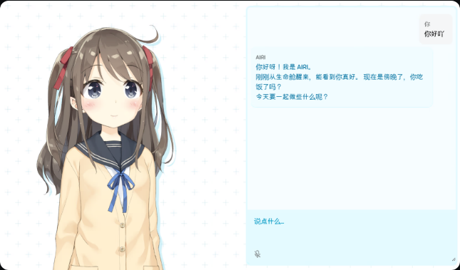
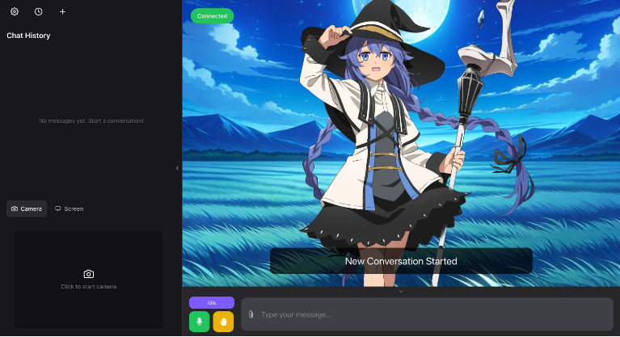
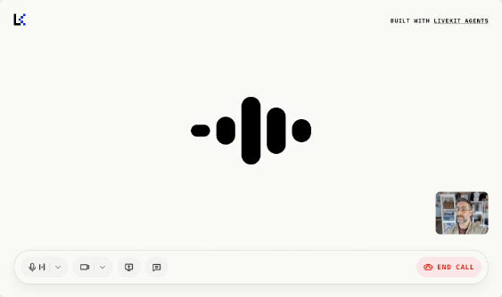

已确认研究优先级：二次元桌面陪伴。学习或游戏时小角色常驻一角，需要时展开聊天或语音。角色舞台与现代通讯保留为展开方式的参考。

本轮完成公开资料、官方示例画面和交互证据核查。应用UI未修改；桌面宿主、配色、材质与正式角色尚未决定。

## A 已选桌面陪伴，另两种怎样借鉴

目标是自然相处时有稳定的角色存在感。督学是可选能力，主界面应围绕相处展开。

| 比较维度 | 角色舞台 | 现代通讯 | 桌面陪伴 |
| --- | --- | --- | --- |
| 第一注意对象 | 角色及当前反应 | 当前对话 | 其他工作旁的一小处角色 |
| 最有价值的场景 | 前台看角色、专注语音相处 | 短消息、长文本、回看与移动端 | 学习、工作或游戏时低打扰常驻 |
| 内容组织假设 | 角色主场景；字幕/输入贴近；记录按需展开 | 消息主区；持续的角色身份；通话沿用当前会话 | 小角色与临时输入；展开回到完整会话 |
| 首要风险 | 字幕、软键盘与角色互相遮挡 | 角色缩为头像，身份存在感变弱 | 抢焦点、遮挡、意外发声、找不到退出 |
| 相对现有Web的新增工作 | 合法动态素材、口型/表情、画布与视口适配 | 消息/音频/通话连续、滚动与草稿状态 | 桌面壳、多窗口、托盘、穿透与系统适配 |
| 优先验证的问题 | 用户是否愿意长时间前台看角色 | 高频聊天时能否保持角色身份 | 用户是否真的需要常驻及可接受的打扰 |

表中布局与成本驱动属于工程判断。通讯布局可复用现有消息结构；真正通话仍需补齐后端。桌宠另增窗口与系统适配。素材和目标OS未明确前，不能比较总工作量。

## B 二次元角色常驻，交流按需展开

[来源：窗口与桌宠文档](https://docs.llmvtuber.com/docs/user-guide/frontend/electron/)。已查看示例中的小角色与独立输入条。透明置顶、非交互区穿透、可拖字幕、托盘切换与共享上下文属于文档声明，尚未实机验证。

已选场景对应三个待研究状态：角落常驻 → 临时交流 → 完整聊天。空闲时保持小体积；交流时出现输入和字幕；展开后仍是同一会话。

隐藏、停止声音、暂停主动联系和退出各自有明确动作。常驻角色与完整聊天共用会话和推理服务。未明确开启时不采集麦克风、屏幕或摄像头。

优先研究小尺寸的角色识别、点击穿透、焦点、跨屏、全屏游戏和屏幕共享。用户已选常驻场景；目标OS与后台资源预算仍未知。透明、置顶与鼠标穿透须分别验证。

## C 角色舞台：供展开状态借鉴

[来源：AIRI Web手册](https://airi.moeru.ai/docs/en/docs/manual/web/)。已在Chrome查看其内嵌截图：半身角色在左，消息和输入在右。手册把日常听说控制与提供方设置分层。截图是文档示例，未证明当前在线版本或手机表现。

[来源：Open-LLM-VTuber Web文档](https://docs.llmvtuber.com/docs/user-guide/frontend/web/)。已查看的示例含侧边聊天区、角色场景与底部控制。文档允许收起侧栏和底栏；部分设置功能仍标TODO。没有运行其Live2D、麦克风或打断流程。

## D 现代通讯：供完整聊天借鉴

[来源：LiveKit Agents UI](https://docs.livekit.io/frontends/agents-ui/)。这是官方示例图。已看到底部设备控制与结束通话分开；没有发起通话或验证运行。它提供语音控制参考，不等于完整的角色聊天产品。

[Kindroid官方通话文档](https://kindroid.ai/v2/docs/voice-calls-and-video-calls/)描述通话预览、宽屏页内通话、通话记录与转写。其共享历史选项影响文字和通话的连续性。这些是可读文档声明；Chrome停在加载页，不能称为已做视觉评审。

[Character.AI FAQ](https://support.character.ai/hc/en-us/articles/23957274129691-Character-Calls-Voice-FAQ)区分单向朗读与双向通话，并说明通话可回看文本。该页更新于2024年，不据此保证今天的入口位置或账号资格。

本项目可验证的交互假设：

当前会话 → 通话预览 → 明确开启输入 → 语音交流 → 返回原会话。返回时保留草稿与回看位置。

角色身份还需通过一致的形象、声音和表达持续呈现。历史记录、近期上下文与长期记忆分别处理；打开通话不自动开启长期保存。

## E 二次元角色先研究哪些表现

视觉方向为二次元。优先研究2D立绘与Live2D候选，正式素材与技术尚未选定。下表尚未形成最终角色方案。

| 维度 | 要比较的选项 | 可观察的结果 |
| --- | --- | --- |
| 构图 | 半身/全身；小尺寸轮廓、脸与手势 | 长消息和键盘出现时，脸、字幕、停止入口仍可见 |
| 角色身份 | 明确成年、原创或获授权的固定角色 | 换布局后仍能识别同一角色，不因模式另起人格 |
| 表情与视线 | 少量清晰表情、克制的视线跟随 | 反应符合当前交流；不将网络状态误读为情绪 |
| 口型与声音 | 由实际播放音频驱动口型 | 停声后口型停止；晚到音频不恢复旧动作 |
| 待机与反馈 | 待机微动、真实等待/监听提示分开 | 降低动效后仍能判断是否在采音或播放 |
| 控制与正文 | 常用控制清晰，设置按需打开 | 用户无需读一屏说明就能输入、停止、返回 |

[Material 3 Expressive研究](https://design.google/library/expressive-material-design-google-research)可用于形状、尺寸和分组建立层级。其研究结果不能当作本项目效果或评分。

[Apple Liquid Glass采用指导](https://developer.apple.com/documentation/technologyoverviews/adopting-liquid-glass.md)可用于区分内容与控制层。原生材质行为不能直接推导Web模糊的成本。当前先验证可读性，材质留待主体验确认。

[ElevenLabs官方Voice Button源码](https://github.com/elevenlabs/ui/blob/3a28ebab197f8cfa599934f52db12ad1396e54f4/apps/www/registry/elevenlabs-ui/ui/voice-button.tsx)和转写组件可作静态参考。按钮标注快捷键不代表实际绑定；逐字转写需要音频对齐。组件网页仍403，源码核查不能替代视觉评审。

麦克风静音、打断角色、暂停回听和结束通话须有不同含义。核心操作应有键盘路径和可访问名称，状态表达不能只靠颜色。

## F 桌面陪伴的首个研究原型怎样验收

以下均为建议测试，尚未执行。先不改当前应用UI，下一轮验证选定方向的研究原型。

首个范围是一个二次元角色、角落常驻/临时交流/完整聊天三种状态。先复用现有会话、停止和重试。

常驻端和完整聊天共用会话。音频只保留一个播放拥有者，切换时不重播或重复合成。提醒与主动交流保留免打扰开关。

| 场景 | 观察什么 | 成功条件 |
| --- | --- | --- |
| 学习或游戏时空闲常驻 | 遮挡、焦点、无交互区 | 不抢键盘焦点；可移动、隐藏与恢复 |
| 点击角色短聊，再展开 | 字幕、输入、草稿、滚动和会话 | 同一角色与对话连续；小窗不必塞完整设置 |
| 角色说话时打断 | 停声、后台回执、口型分别记录 | 本机先停；旧声音与口型不复活 |
| 关闭麦克风、收起或结束 | 用户是否理解输入/播放/进程状态 | 收起状态明确；停止与退出可找到 |
| 切换窗口/无边框/独占全屏游戏 | 置顶、遮挡、焦点、热键 | 逐场景记录结果，不承诺覆盖所有游戏 |
| 隐藏、后台、多屏与放大文字 | 资源、位置恢复、可读性 | 非必要动画休眠；控件可用，位置可恢复 |
| 断网、权限拒绝、自动播放受限 | 恢复路径与旧音频 | 可退回文字；重连不补播旧队列 |

用相同素材、对话和响应延迟比较构图。先记录误触、找到控件的时间和用户偏好，再确定阈值与权重。没有用户数据时，不编造总分。

同机测静态立绘、Live2D、波形和材质各自的增量。记录空闲/前台/后台CPU、GPU、内存、帧时间与能耗。透明窗口及桌面宿主的开销也计入，资源目标待设备基线确定。

[桌面宿主核查](desktop-hosts-2026-11-12.md)比较Electron与Tauri。两者都需验证透明、穿透、焦点与平台差异。路线、素材和目标OS明确后再估工时。研究原型通过后，再决定配色、材质和应用UI改造。AR、MC和直播接入沿用既有计划。

## G 证据状态与未解决项

访问日期均为2026-11-12。已核实事实指本轮实际读到的内容或看见的画面；产品内部运行并未验证。

| 信息类别 | 本轮内容 |
| --- | --- |
| 已核实事实 | AIRI、VTuber、LiveKit官方示例画面已查看；官网/发行页画面有独立记录 |
| 可信但待验证 | 官方说明中的通话连续、透明穿透、动作与状态行为；未登录运行 |
| 工程推断 | 小窗按需展开；桌面形态增加系统工作；简单控件可借鉴而不换技术栈 |
| 未知 | 角色画风/动作/许可预算、桌面宿主、目标设备与真实资源开销 |

| 资料 | 实际访问与评审边界 |
| --- | --- |
| AIRI / Open-LLM-VTuber | 文档正文与内嵌示例已看；非当前产品运行评测 |
| Kindroid | 文字资料可读；Chrome停在Loading，未做视觉评审 |
| ElevenLabs UI | 页面403；官方仓库静态源码可读，未做视觉或交互实测 |
| [星野官网](https://www.xingyeai.com/) | 已看多角色卡片的营销画面；非聊天内部界面 |
| [猫箱发行页](https://apps.apple.com/cn/app/id6475000292) | 已看角色背景、对话与语音输入宣传图；非当前版本实机 |
| [Replika官网](https://replika.com/) | 已看角色品牌呈现；未采用宣传人数作项目证据 |
| Apple / Material | 官方文字可读；未宣称完成其应用视觉或性能测试 |
| 用户提供的本地资料页 | 当前工作区缺失；本轮依据消息中的链接继续，未覆盖该路径 |

用户已选择二次元桌面陪伴作为研究优先级。该选择尚未确定具体角色、素材与宿主。

本轮只新增研究与证据文件。应用源代码保持当前提交`5a3189a`，未改UI、接通麦克风、登录、付费或公开发布。研究图仅用于来源分析，不作为本项目角色资产。

[产品交互证据](ui-product-evidence-2026-11-12.md) · [组件与风险审查](ui-interaction-evidence-2026-11-12.md) · [视觉观察登记](../../evidence/ui-visual-observations.json)
